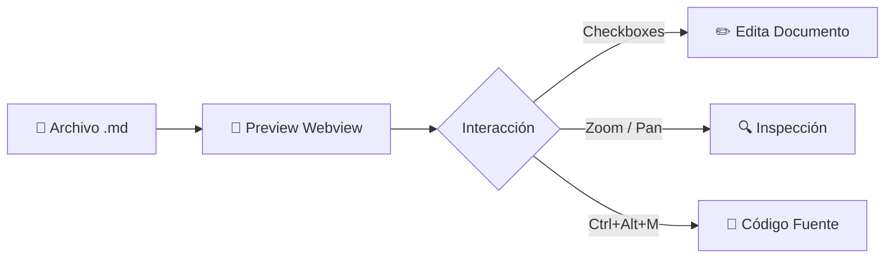

# 🧪 Test de Funcionalidades - MD Preview Default

Archivo Markdown diseñado para verificar visual e interactivamente cada una de las capacidades de la extensión.

---

## 1. Encabezados e Índice Lateral (TOC)

El panel lateral derecho muestra la estructura del documento generada a partir de los encabezados (`H1` a `H4`).
- **Prueba**: Haz clic en cualquier sección del índice para desplazarte suavemente hasta ella.
- **Botón de alternancia**: Prueba ocultar/mostrar el TOC con el botón **☰** arriba a la derecha.

### Subsección de Demostración 1.1
Párrafo de prueba para comprobar indentación en el TOC.

#### Detalle de Nivel 4 (1.1.1)
Nivel máximo monitoreado por el TOC.

---

## 2. Bloques de Código y Botón Copiar

Bloque con resaltado de sintaxis (`TypeScript`) y botón interactivo para copiar:

```typescript
interface PreviewSettings {
  fontSize: number;
  contentWidth: number;
}

export function greet(name: string): string {
  return `¡Hola, ${name}! Bienvenido a MD Preview Default.`;
}
```

- **Prueba**: Pasa el cursor por el bloque, observa la etiqueta de lenguaje arriba a la derecha y haz clic en el botón **Copiar**.

---

## 3. Callouts Estilo GitHub (Alerts)

> [!NOTE]
> Este es un callout de tipo **Nota** para información general.

> [!TIP]
> Este es un callout de tipo **Consejo** con recomendaciones útiles.

> [!IMPORTANT]
> Este es un callout de tipo **Importante** para resaltar algo crítico.

> [!WARNING]
> Este es un callout de tipo **Advertencia** para prevenir errores.

> [!CAUTION]
> Este es un callout de tipo **Precaución** para acciones de alto riesgo.

---

## 4. Diagramas Mermaid con Zoom y Pan

Diagrama interactivo renderizado con Mermaid:



- **Prueba**: Usa la rueda del mouse sobre el diagrama para hacer **zoom**, arrastra con el cursor para hacer **pan**, y usa los botones de control flotantes (+, -, reset).

---

## 5. Matemáticas con KaTeX

Soporte tanto para fórmulas en línea como en bloque independiente:

- **En línea**: La famosa relación masa-energía de Einstein es $E = mc^2$, y la fórmula de Euler es $e^{i\pi} + 1 = 0$.
- **En bloque**:

$$f(x) = \int_{-\infty}^{\infty} \hat{f}(\xi)\,e^{2 \pi i \xi x}\,d\xi$$

---

## 6. Listas de Tareas Interactivas (Task Lists)

Casillas de verificación directamente editables desde el Preview:

- [x] Tarea completada inicial
- [x] Tarea pendiente (haz clic para marcar)
- [x] Otra tarea pendiente

- **Prueba**: Haz clic en cualquier casilla desmarcada; el cambio se sincronizará automáticamente con el documento fuente en VS Code.

---

## 7. Imágenes con Visor Modal y Zoom

Imagen remota para probar el visor integrado:


- **Prueba**: Haz clic sobre la imagen para abrirla en pantalla completa con visor de zoom/paneo. Presiona `Esc` o el botón `✕` para cerrarla.

---

## 8. Listas de Definición y Emojis

**Emojis:** :rocket: :sparkles: :tada: :art: :bulb: :heavy_check_mark:

**Lista de Definición:**
Markdown
: Lenguaje de marcado ligero creado para formatear texto plano de forma legible.
KaTeX
: Motor rápido de renderizado matemático para la web.
Mermaid
: Herramienta de diagramación basada en texto similar a Markdown.

---

## 9. Tablas y Notas al Pie

| Característica | Estado | Atajo / Control |
| :--- | :---: | :--- |
| Alternar Source/Preview | Soportado | `Ctrl+Alt+M` |
| Búsqueda integrada | Soportado | `Ctrl+F` o botón 🔍 flotante |
| Sincronización de cursor | Soportado | Doble clic / navegación |

Texto con una referencia a nota al pie[^1] y otra aclaración[^info].

[^1]: Esta es la primera nota al pie, con enlace interactivo de retorno.
[^info]: MD Preview Default sanitiza el HTML para garantizar seguridad.

---

## 10. Buscador Integrado (Ctrl+F)

- **Prueba**: Presiona `Ctrl+F` o haz clic en el icono flotante de lupa **🔍** (abajo a la derecha).
- Escribe cualquier palabra presente en este documento (por ejemplo: `Mermaid` o `KaTeX`), navega con `Enter` / `Shift+Enter` y observa el contador de coincidencias y el resaltado nativo.
